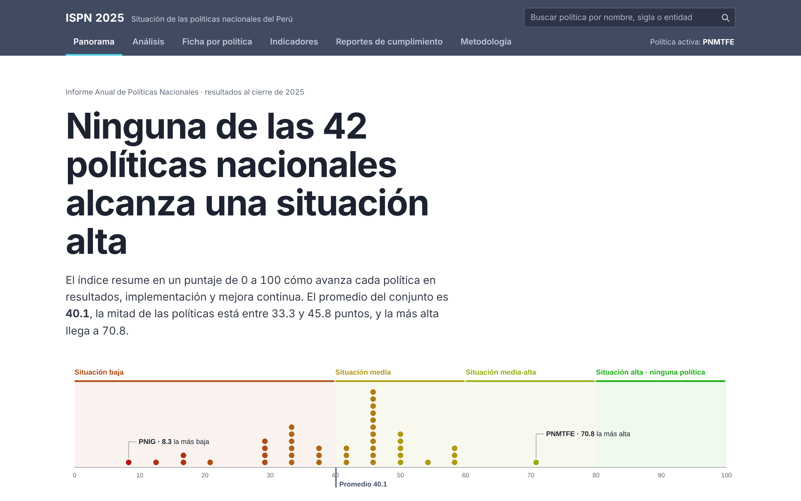
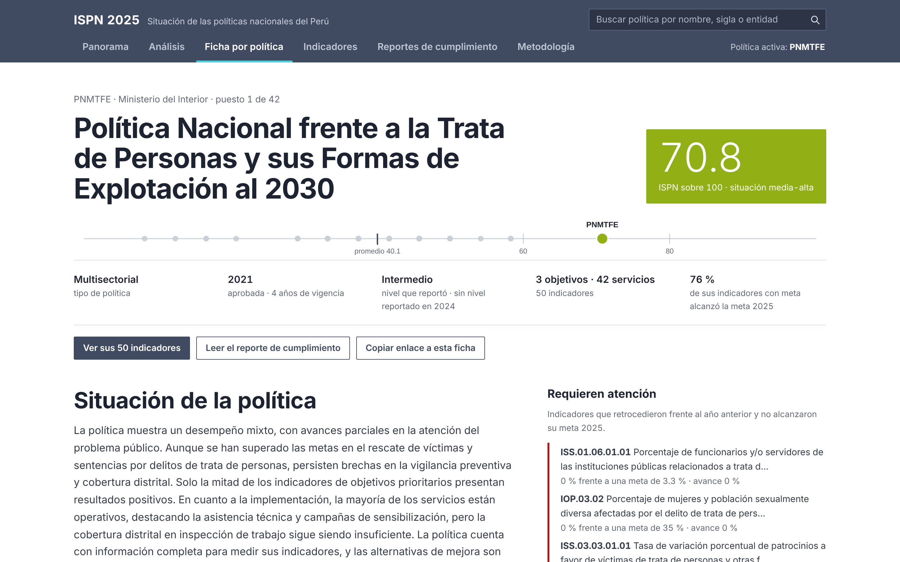

# ISPN 2025 · Consulta de las políticas nacionales del Perú

Tarea 3 del curso Python Intermedio — Diplomatura en Ciencia de Datos (QLAB).

**Dashboard:** [Abrir tablero](https://AlexNoblejas.github.io/tablero_ispn_2025/) · **LinkedIn:** [Ver publicación](https://lnkd.in/p/db3SuAuy)

## Tema y pregunta de investigación

**Tema:** situación de las 42 políticas nacionales del Perú al cierre de 2025 según el
Índice de Situación de la Política Nacional (ISPN), publicado por el CEPLAN en el
Informe Anual de Políticas Nacionales 2025.

**Pregunta:** ¿en qué situación están las políticas nacionales, qué componente frena
más su avance y qué se asocia a un mejor resultado más allá de lo que el propio índice
mide?

**Cobertura:** las 42 políticas nacionales vigentes del Perú —alcance nacional, sin
desagregación territorial—, con resultados al cierre de 2025 y series de indicadores
desde 2019.

## El proyecto

El informe anual es un documento extenso. Este tablero lo convierte en una herramienta
de consulta para quien toma decisiones sobre una política: en un minuto se ve cómo está,
por qué y qué tendría que cambiar; en diez, se llega al indicador y al párrafo del
reporte que lo sustenta.

| Pestaña | Qué permite hacer |
|---|---|
| Panorama | Ver las 42 políticas sobre la escala del índice, el perfil de los seis criterios y el cruce entre mejora anual y cumplimiento de metas |
| Análisis | Relacionar el índice con variables que **no** forman parte de su cálculo; comparar mejora y meta por política; ver qué estándares de servicio rinden menos; contrastar la autovaloración de las rectorías; ordenar la matriz de puntajes |
| Ficha por política | Posición entre las 42, perfil frente al promedio, simulador de la ruta a la siguiente franja, indicadores que requieren atención y mapa objetivo → servicio → indicador con series en miniatura |
| Indicadores | Filtrar 2,480 indicadores por resultado, meta y estándar; ver la serie 2019–2025 y el comentario de la entidad; descargar la selección en CSV |
| Reportes de cumplimiento | Leer el reporte de cada política con índice lateral, búsqueda, notas al pie agrupadas y marcadores donde el original tenía gráficos o tablas |
| Metodología | Fórmula, rúbricas, fuentes, verificación, calidad de datos y criterios de interpretación |

Cada ficha tiene enlace propio (`#/ficha/PNMTFE`) y la política elegida se mantiene al
pasar de una pestaña a otra. La paleta de color es la escala oficial del ISPN.

El autor integró el equipo técnico de los informes correspondientes a 2024 y 2025.

## Datos y metodología

Fuentes:

1. [Informe Anual de Políticas Nacionales 2025, CEPLAN](https://www.minsa.gob.pe/Recursos/OTRANS/09GestionIns/informe/2026/Informe-Anual-de-Pol%C3%ADticas-Nacionales-2025.pdf) (edición julio de 2026, copia pública alojada por MINSA).
2. Resultados de la evaluación del ISPN 2025 por política, criterio e indicador (versión
   sin indicadores complementarios, que sustenta el informe).
3. Reportes de cumplimiento 2025 de las rectorías y conductoras; reportes 2024 para el
   nivel de implementación del año anterior.
4. Reporte de seguimiento de los indicadores de políticas nacionales, 2019–2025: valores
   obtenidos, metas, avance hacia la meta, estándar de cumplimiento y comentario de la
   entidad.
5. Matriz de consistencia de las políticas nacionales aprobadas.

`ISPN = 100 × promedio((puntaje − 1) / (máximo − 1))` sobre los seis criterios. Franjas:
baja (menos de 40), media (40 a 59.9), media-alta (60 a 79.9) y alta (80 a más).

`scripts/preparar_datos.py`:

- recalcula el índice de cada política y lo contrasta con el libro de evaluación;
- **verifica contra el informe publicado** y se detiene si alguna cifra no coincide;
- une cada indicador con su serie, su meta, su avance tipo I y su estándar;
- cruza mejora frente al año anterior con cumplimiento de la meta 2025;
- reconstruye los textos de los reportes que Excel cortó por longitud y los convierte en
  bloques (párrafos, viñetas, marcadores de figura, fuentes, notas al pie);
- señala, sin corregir, los indicadores porcentuales registrados en escalas distintas
  entre años.

Cifras del informe que el procesamiento reproduce: 42 políticas; promedio 40.1; máximo
70.8; mínimo 8.3; 18 en situación baja, 23 en media, 1 en media-alta y ninguna en alta;
y las proporciones de la síntesis (40, 17, 26, 22, 15, 32 y 9 políticas).

Quedan fuera del tablero el control de calidad, los historiales de revisión, los niveles
de confianza, las alertas internas, las marcas de tiempo y cualquier dato personal o
credencial presente en las bases de origen.

## Hallazgos principales

1. **Ninguna política alcanza una situación alta.** El máximo es 70.8 y lo obtiene una
   sola política; 41 de 42 están en situación baja o media, y el promedio es 40.1. El
   índice no mide el bienestar de la población: resume lo que el reporte de cada
   política permite acreditar, de modo que un puntaje bajo señala muchas veces
   información que falta.
2. **Los servicios se entregan, pero la brecha no se cierra.** La implementación es el
   criterio mejor evaluado de los seis —3.4 sobre 5 en promedio, 60.1 % del estándar— y
   aun así, en 40 de 42 políticas el reporte no permite acreditar que el problema público
   que les dio origen esté mejorando. De 26 políticas con la mayoría de sus servicios en
   marcha, solo 15 muestran resultados favorables en la mitad de sus indicadores de
   servicio. Entregar el servicio es condición necesaria, no suficiente.
3. **La respuesta de mejora tampoco es específica.** El criterio 6 califica, en una
   escala de 1 a 3, las alternativas que cada entidad propone para mejorar la
   implementación. Solo **9 de 42** llegan al nivel 3 (alternativas específicas y
   viables, que permiten identificar quién hace qué). **21** se quedan en el nivel 2
   —medidas de carácter general, sin precisar acciones ni mecanismos— y **12** en el
   nivel 1: no reportaron alternativas, se limitaron a ajustes de diseño o reiteraron
   medidas anteriores sin informar avances. Es decir, en 33 de 42 el diagnóstico anual
   no se traduce en medidas concretas.

También, sin interpretar por el lector: de los 1,336 indicadores que tienen a la vez
comparación con el año anterior y avance respecto de su meta 2025, en 409 las dos
señales no coinciden —206 mejoran sin alcanzar la meta y 203 la alcanzan sin haber
mejorado; en 177 de esos 203 el valor del año anterior ya igualaba o superaba la meta
fijada para 2025—. Y el índice tiene una correlación negativa moderada con los años de
vigencia (r = −0.37) y con el número de indicadores por servicio (r = −0.35); las
políticas multisectoriales promedian 42.3 y las sectoriales, 33.7.

## Limitaciones

- El índice resume lo que el reporte de cada política permite acreditar; no mide
  impacto en la población.
- Un puntaje bajo puede deberse a falta de información.
- Los resultados de 2025 no son comparables con los de informes anteriores.
- Las correlaciones son asociaciones descriptivas entre 42 casos.
- El simulador es ilustrativo: muestra cuánto cambia el índice, no qué tan factible es.
- El tablero no incluye mapa: el índice se calcula por política nacional, con alcance
  nacional y sin desagregación territorial.
- Los valores y textos se muestran tal como los registró cada entidad; los gráficos y
  tablas de los documentos Word originales no se conservan.

## Estructura

```
├── README.md
├── requirements.txt
├── datos/LEEME.md            # de dónde salen las fuentes y por qué no se versionan
├── scripts/
│   ├── preparar_datos.py     # limpieza, unión de fuentes, verificación
│   └── empaquetar.py         # arma web/data.js y la versión autocontenida
├── web/                      # carpeta publicada en GitHub Pages
│   ├── index.html
│   ├── data.js               # políticas, criterios, estándares e indicadores
│   └── data/
│       ├── *.json            # tablas derivadas
│       └── rc/rc_0NN.json    # un reporte por política, carga bajo demanda
└── reel/
    ├── LEEME.md              # cómo se arma el reel, paso a paso
    ├── salidas/guion.json    # guion de 6 escenas y los tres posts
    ├── salidas/reel.mp4      # el reel, con sus subtítulos en reel.srt
    ├── hacer_imagenes.py     # los seis gráficos, desde los datos del tablero
    ├── hacer_capturas.py     # capturas del tablero, para el reel y LinkedIn
    ├── hacer_musica.py       # la pista de fondo, sintetizada
    ├── reel_visual.py        # extiende reel.py de la clase: gráficos + música
    └── hacer_reel_visual.py  # arma el reel con la voz clonada

fuentes/                      # hermana del repositorio, NO se versiona
└── los seis archivos de origen
```

Las fuentes quedan fuera del repositorio a propósito: las bases de trabajo incluyen
credenciales y datos de contacto de coordinadores de los ministerios. `datos/LEEME.md`
explica qué contienen y cómo obtenerlas.

## Cómo reproducirlo

```bash
pip install -r requirements.txt
python scripts/preparar_datos.py   # lee ../fuentes/ y verifica contra el informe
python scripts/empaquetar.py
python -m http.server 8000 --directory web
```

`preparar_datos.py` se detiene si alguna cifra no reproduce el informe publicado. Si
las fuentes están en otra carpeta, define la variable de entorno `ISPN_FUENTES`.

Publicación: en GitHub, *Settings → Pages → Source*, elegir la
opción **Deploy from a branch**, rama `main` y carpeta `/ (root)`. El archivo `index.html` abre el tablero de `web/`; `.nojekyll` permite servir los archivos estáticos directamente.

## El reel

Un reel vertical de 53,2 segundos resume los hallazgos para público general: seis escenas,
un gráfico de datos reales en cada una, la última con el tablero mismo en pantalla.
La narración se generó clonando la voz del autor con Qwen3-TTS 0.6B, los subtítulos salen de
Whisper palabra por palabra, y la música de fondo es una pista propia sintetizada con
numpy, mezclada dieciséis unidades por debajo de la voz. El video lleva visible el aviso
de que la voz fue generada con IA.

Todas las cifras del guion pasan el validador de cifras de la sesión 15 del curso contra
este README, que a su vez `preparar_datos.py` verifica contra el informe publicado.

`reel/LEEME.md` tiene el paso a paso. En corto:

```bash
cd reel
uv venv .venv
uv pip install --python .venv/bin/python -r requirements.txt
python prueba_diseno.py          # revisa el diseño sin gastar el TTS
.venv/bin/python hacer_reel_visual.py --voz mi_voz.wav --autor "Alexander Noblejas" \
    --fuente "CEPLAN, Informe Anual de Políticas Nacionales 2025" \
    --musica musica/fondo.wav --credito-musica "pista original generada con hacer_musica.py"
```

## Uso de inteligencia artificial

El tablero se desarrolló con asistencia de Claude y Codex para el procesamiento de datos, el
código, el diseño de la interfaz y la redacción. La elección del tema, las fuentes, la
verificación contra el informe oficial y las decisiones sobre qué publicar son
responsabilidad del autor. La narración del reel se generó con Qwen3-TTS clonando la
voz propia del autor, y así se declara en el video.

---

Visualización independiente. No es una publicación oficial del CEPLAN; ante cualquier
diferencia prevalece el informe publicado.

## Capturas del tablero





## Estado de la entrega

El tablero y el reel están terminados y verificados localmente. La publicación de LinkedIn está disponible en el enlace anterior. Queda pendiente el comentario de entrega en el issue del curso. El tablero se publica con GitHub Pages desde la rama `main`. El video final está en [reel/salidas/reel.mp4](reel/salidas/reel.mp4) y el borrador de LinkedIn en [publicacion_linkedin.txt](reel/salidas/publicacion_linkedin.txt).
